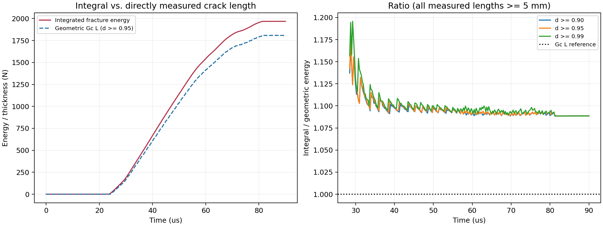
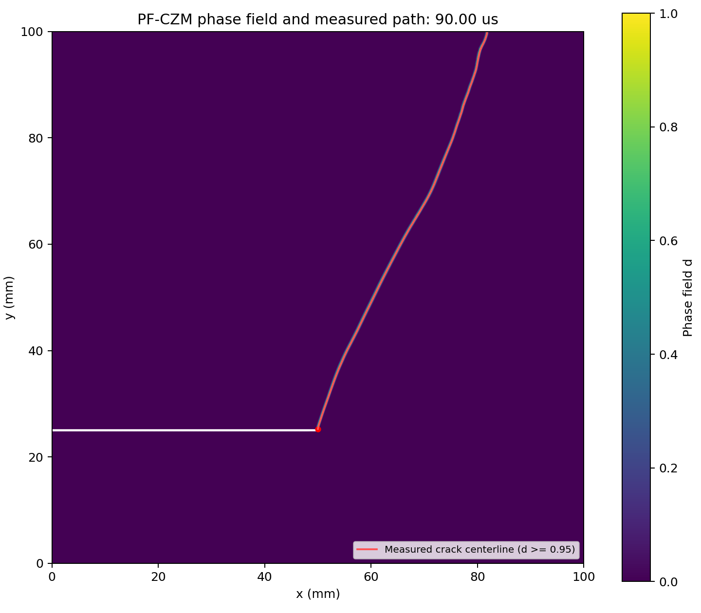
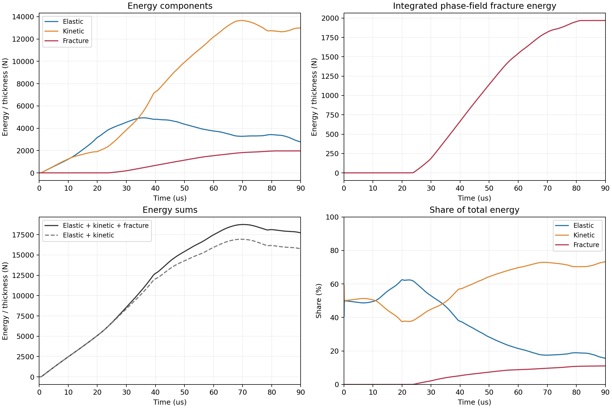

# Kalthoff–Winkler Dynamic Shear Test: Overestimation of Phase-Field Fracture Energy

This project uses **FreeFEM++, MPI, and PETSc** to simulate the Kalthoff–Winkler dynamic shear test and investigate why the fracture energy obtained by integrating the phase-field energy density over the domain exceeds the geometric fracture energy calculated from the actual crack length.

The current public implementation uses **PF-CZM, a current-state Wuplus driving force, a lower-bound constraint enforcing damage irreversibility, and proportional degradation of stiffness and mass**. At the final time step, the integrated fracture energy is **1968.26 N**, whereas the geometric fracture energy is **1807.98 N**, an overestimation of **8.87%**. The research motivation, mechanism analysis, result definitions, running instructions, and evolution videos are presented below.

## 1. Research Motivation

While studying previous phase-field models for dynamic fracture, the author found that some models reproduce the crack path in the Kalthoff–Winkler test reasonably well but exhibit **anomalously high integrated fracture energy**. For models with a constant fracture toughness $G_c$, the quantity $G_cL$, calculated from the actual length of the newly formed crack, provides an important reference for assessing the energy dissipated per unit crack length.

This phenomenon has also been reported in the classical literature. For example, [Borden et al. (2012)](https://doi.org/10.1016/j.cma.2012.01.008) present the dynamic shear benchmark in §4.3 and discuss the substantial excess of integrated dissipated energy over the geometric estimate in Remark 4.5, noting the possible influence of irreversibility treatment and diffuse damage induced by stress waves.

This project addresses the following question: **To what extent does this overestimation arise from the finite element representation, interactions between waves and the damage band, and irreversibility treatment, rather than an explicitly prescribed increase in dynamic toughness?** In the current code, $G_c$ is constant; no velocity-dependent $G_c(v)$ is specified.

## 2. Five Categories of Influencing Factors Considered by the Author

The following factors constitute the author's analysis of the mechanisms behind fracture energy overestimation. These factors may be coupled, and the current benchmark does not provide an independent causal demonstration for each one.

### 2.1 Mesh Size and the Nearly Fully Fractured Plateau

For an ideal crack, the extreme values are concentrated along the crack centerline. On a finite mesh, a **nearly fully fractured plateau** consisting of one or more elements may form near the phase-field maximum. Its nonzero area increases the local fracture energy. For models introducing an auxiliary variable $w$, the region near the extreme values of $w$ and the energy contribution associated with its finite width should also be examined. The PF-CZM implementation published in this repository solves only for the phase field $d$ and does not include an independent $w$ field.

The integrated fracture energy in this code is

$$
E_{\mathrm{frac}}
=\frac{G_c}{\pi}\int_\Omega
\left[\frac{2d-d^2}{\ell}+\ell|\nabla d|^2\right]\,\mathrm dA.
$$

For an isolated, fully developed ideal one-dimensional crack, the profile in the normal direction is

$$
d(s)=
\begin{cases}
1-\sin(|s|/\ell), & |s|\leq\pi\ell/2,\\
0, & |s|>\pi\ell/2.
\end{cases}
$$

If a plateau of width $b$ with $d\approx1$ is inserted at the center while the theoretical profiles on either side remain unchanged, the additional local energy is approximately

$$
\Delta E_{\mathrm{platform}}\approx\frac{G_cLb}{\pi\ell},
\qquad
\frac{\Delta E_{\mathrm{platform}}}{G_cL}\approx\frac{b}{\pi\ell}.
$$

Therefore, the ratios between the plateau width, mesh size, and regularization length affect the integrated result.

### 2.2 Mass Degradation and Stress-Wave Propagation

If the elastic stiffness is degraded by $g(d)$ while the density remains unchanged, the wave speed decreases with damage under a local elastic approximation with uniform degradation of the stiffness:

$$
c(d)=\sqrt{\frac{g(d)C_0}{\rho_0}}=\sqrt{g(d)}\,c_0,
$$

Here, $C_0$ denotes the elastic modulus associated with the corresponding wave mode. The reduced wave speed and changes in impedance within the damage band may cause wave reflection, trapping, and repeated interactions, which can induce additional damage and progressively widen the phase-field profile. This mechanism has also been investigated by [Durussel et al. (2026)](https://doi.org/10.1016/j.cma.2026.118942).

The current code applies the same degradation factor, $g(d)+\mathrm{SMALL}$, to the full elastic stiffness and inertial density to preserve the local wave-speed ratio above. However, **mass degradation reduces the system mass and introduces kinetic energy loss**. Preserving the local wave speed does not ensure mass or energy conservation, nor does it mean that the wave-reflection behavior of an actual crack surface has been fully recovered.

### 2.3 Irreversibility Constraints and Profile Recovery

For the theoretical localization profiles of certain phase-field models, the damage half-bandwidth decreases as the peak phase-field value increases. During this evolution, damage must decrease at some locations to recover the corresponding theoretical profile. The pointwise irreversibility constraint

$$
d_n(\boldsymbol x)\geq d_{n-1}(\boldsymbol x)
$$

prevents this recovery, retaining the previously wider damage distribution and increasing the integrated fracture energy. This mechanism depends on the model's geometric function, degradation function, and loading path; it cannot be generalized to imply that all phase-field models follow the same half-bandwidth evolution law.

### 2.4 Regularization Length and Γ-Convergence

Γ-convergence provides a theoretical framework for approximating sharp-crack energy with diffuse-crack energy. For regularizations satisfying the relevant convergence conditions, the diffuse fracture energy can approach the corresponding sharp-crack energy as the regularization length tends to zero, provided that conditions such as adequate mesh resolution of the damage band are met.

### 2.5 Influence of History Variables on the Phase-Field Distribution

Replacing the current driving force with its historical maximum, for example,

$$
\mathcal H(\boldsymbol x,t)=\max_{\tau\leq t}\psi^+(\boldsymbol x,\tau),
$$

retains information about past peaks. After unloading or the passage of a stress wave, this treatment may continue to sustain a wider damage distribution, causing the profile to deviate from the energy-optimal distribution for the current state and increasing the integrated fracture energy.

This implementation recalculates `Wuplus_current` from the current displacement, **without accumulating a historical maximum**, and enforces irreversibility using a PETSc solver with lower and upper bounds.

## 3. Simulation Results and Fracture Energy Comparison

### 3.1 Model and Parameters

| Item | Current Setting |
|---|---|
| Computational model | Two-dimensional plane stress, PF-CZM, linear-softening parameters |
| Young's modulus $E$ | 190000 MPa |
| Poisson's ratio $\nu$ | 0.3 |
| Initial density $\rho_0$ | 0.008 g/mm³, equivalent to 8000 kg/m³ |
| Fracture toughness $G_c$ | 22.2 N/mm, constant |
| Strength parameter $\sigma_0$ | 2812.25 MPa |
| Regularization length $\ell$ | 0.25 mm |
| Mesh | `mesh/shear_fixed_70deg.msh` |
| Mesh size | 179982 nodes and 358695 triangles |
| Displacement and damage discretization | P1 triangular finite elements; P0 for the current driving force |
| Time integration | Newmark, $\beta=1/4$, $\gamma=1/2$ |
| Time step | $5\times10^{-5}$ ms, equivalent to 0.05 μs |
| Total duration | 1800 steps, equivalent to 90 μs |
| Loading velocity | Increases linearly to 16.54 mm/ms over 1 μs, then remains constant |
| Proportional damping | Both mass- and stiffness-proportional damping coefficients are 0 |
| History variable | Not used; current-state Wuplus driving force |
| Irreversibility | $d_{n-1}\leq d_n\leq1$ |
| Mass treatment | Degraded proportionally to the full elastic stiffness, with residual coefficient `SMALL=1e-8` |

The degradation function is

$$
g(d)=\frac{(1-d)^2}{(1-d)^2+a_1d-\frac12a_1d^2},
\qquad a_1=\frac{4EG_c}{\pi\sigma_0^2\ell}.
$$

The alternating iterations use the maximum damage increment `damagethreshold=1e-2` as the stopping threshold, with a maximum of 500 iterations. The phase-field problem uses PETSc `vinewtonrsls`, with `snes_rtol=1e-5` and `snes_atol=1e-6`. These tolerances should also be retained or subjected to sensitivity checks when reproducing the experiment.

### 3.2 Integrated Fracture Energy, Geometric Fracture Energy, and Error

The geometric fracture energy is calculated from the independently extracted crack length:

$$
E_{\mathrm{geom}}=G_cL,
\qquad R=\frac{E_{\mathrm{frac}}}{G_cL},
\qquad \varepsilon_{\mathrm{frac}}=(R-1)\times100\%.
$$

The primary measurement procedure for $L$ is as follows: main-crack nodes satisfying $d\geq0.95$ are grouped into 0.5 mm bins along the $y$ direction; a median ridge is extracted, its horizontal coordinates are smoothed, and the resulting polyline arc length is calculated. The starting point is the geometric notch tip at $(50,25.25)$ mm. **The initial notch length is excluded, the length is not inferred from the integrated energy, and the two crack faces are not counted twice.** The current final state contains a single main crack; if branching occurs, the arc lengths of all branches must be included.

| Time/μs | Newly Formed Crack Length/mm | Integrated Fracture Energy/N | Geometric Fracture Energy/N | Ratio $R$ | Relative Overestimation |
|---:|---:|---:|---:|---:|---:|
| 30 | 7.4967 | 188.032 | 166.427 | 1.12982 | 12.98% |
| 40 | 27.3213 | 666.454 | 606.533 | 1.09879 | 9.88% |
| 50 | 46.7724 | 1141.156 | 1038.348 | 1.09901 | 9.90% |
| 60 | 63.5743 | 1542.490 | 1411.349 | 1.09292 | 9.29% |
| 70 | 75.0840 | 1817.300 | 1666.865 | 1.09025 | 9.03% |
| 80 | 80.5261 | 1954.277 | 1787.680 | 1.09319 | 9.32% |
| **90** | **81.4403** | **1968.258** | **1807.975** | **1.08865** | **8.87%** |

The energies are **energies per unit thickness** obtained from two-dimensional integration, in N = mJ/mm. For a thickness of 1 mm, the numerical values in the table correspond to mJ. During early crack initiation, the integral includes a damage process zone that is not yet fully developed; ratios for very short cracks should therefore not be used to represent the energy dissipated by a mature crack.





### 3.3 Energy Evolution



At 90 μs, the elastic energy is **2770.04 N**, the kinetic energy is **12989.30 N**, and the fracture energy is **1968.26 N**. Their sum is **17727.60 N**. The external work obtained by integrating the recorded boundary stress-traction force is approximately **17319.79 N**, and the sum of the three energy terms exceeds this work by approximately **2.35%**.

## 4. Project Structure and Running Instructions

### 4.1 Directory Structure

```text
.
├── README.md
├── .gitignore
├── main_half_nohistory.edp         # Main FreeFEM++ MPI program
├── mesh/
│   └── shear_fixed_70deg.msh        # Computational mesh in Gmsh format
├── figure/
│   ├── d.mp4                      # Phase-field evolution video
│   ├── v.mp4                      # Velocity-magnitude evolution video
│   ├── d_preview.png              # Video preview image
│   ├── v_preview.png
│   ├── energy_evolution.png
│   ├── integral_vs_geometric.png
│   ├── geometric_crack_path.png
│   └── final_plateau_profiles.png
└── results/
    ├── captured_time_force.txt     # Raw force and energy histories from the reference run
    ├── integral_vs_geometric_timeseries.csv
    ├── final_crack_centerline.csv
    ├── final_plateau_thresholds.csv
    └── geometric_length_sensitivity.csv
```

`results/` contains the reference postprocessing results cited in this README. Rerunning the main program generates new solver output but does not automatically update these geometric crack lengths or plateau statistics.

### 4.2 Dependencies

- Linux or WSL2 on Windows; this benchmark uses Ubuntu 22.04.
- **FreeFEM++** with MPI support; the existing computational environment uses FreeFEM++ 4.14.
- An available **PETSc** plugin and **HYPRE** preconditioner.
- The FreeFEM++ `iovtk`, `gmsh`, and `shell` plugins, and the standard include file `macro_ddm.idp`.
- An MPI runtime; ParaView is used to inspect output fields and create animations.

For installation instructions, see the [official FreeFEM installation documentation](https://doc.freefem.org/introduction/installation.html). `macro_ddm.idp` is supplied with FreeFEM and is not a missing custom file in this repository.

### 4.3 Running the Simulation

Run the following command from the repository root, ensuring that the relative path `mesh/shear_fixed_70deg.msh` is accessible:

```bash
mpirun -np 14 FreeFem++-mpi main_half_nohistory.edp -v 0
```

To save a log:

```bash
mpirun -np 14 FreeFem++-mpi main_half_nohistory.edp -v 0 > run.log 2>&1
```

Windows users can first enter WSL and then navigate to the project directory. For example, if the current local directory is retained:

```bash
cd /mnt/d/Desktop/w_phm/shear_impact/github
mpirun -np 14 FreeFem++-mpi main_half_nohistory.edp -v 0
```

`14` is the number of MPI processes used in the reference run and can be adjusted to suit the available resources. In the main program, `outputDir` defaults to `output_pfczm_wuplus_mass_nohistory`. Repeated runs overwrite output files with the same names in that directory; change the directory name first if previous results need to be retained.

### 4.4 Solution Procedure and Output

At each time step, the damage from the previous time step is first assigned as the lower bound. The displacement problem and the bound-constrained phase-field problem are then solved alternately. The displacement subproblem uses the Newmark effective system, the current displacement provides the Wuplus driving force, and the phase-field subproblem uses the PETSc reduced-space active-set Newton method. After the alternating iterations, the velocity and acceleration are updated and the results are written.

The program automatically creates:

```text
output_pfczm_wuplus_mass_nohistory/
├── time-force.txt
├── paraview/                      # Initial fields and parallel VTK fields every 5 steps
└── direct/                        # Initial fields and nodal text output every 2 steps
```

The columns in `time-force.txt` are:

```text
time force strain_energy kine_energy crack_energy
```

- `time`: time in ms.
- `force`: integrated stress traction on the loaded boundary, in N/mm.
- `strain_energy`, `kine_energy`, and `crack_energy`: elastic energy, kinetic energy corresponding to the degraded mass, and integrated fracture energy, in N.

Open the `.pvtu` master files for each time in ParaView to read the complete MPI fields. The main fields are `u1`, `u2`, `v1`, `v2`, `exx`, `eyy`, `exy`, `d`, and `Wuplus_current`; `exy` stores the engineering shear strain. The nodal text columns in `direct/` are `x y d dx(d) dy(d) dtd`. The index in each filename is `index/2`, not the original time-step number.

Postprocessing parallel results requires removing MPI overlap; the contributions of all partitions must not simply be summed with duplicates. The current integrated energy output already uses partition weights, while phase-field gradients are calculated from the original field.

## 5. Evolution Videos

### Phase Field and Crack Propagation

<video src="figure/d.mp4" controls preload="metadata" width="800">
  <a href="figure/d.mp4">Play / download the phase-field evolution video</a>
</video>

### Velocity Magnitude and Motion Response under Stress Waves

<video src="figure/v.mp4" controls preload="metadata" width="800">
  <a href="figure/v.mp4">Play / download the velocity-magnitude evolution video</a>
</video>

## References

1. Borden, M. J., Verhoosel, C. V., Scott, M. A., Hughes, T. J. R., & Landis, C. M. (2012). *A phase-field description of dynamic brittle fracture*. Computer Methods in Applied Mechanics and Engineering, 217–220, 77–95. [DOI](https://doi.org/10.1016/j.cma.2012.01.008). See §4.3 for the dynamic shear benchmark and Remark 4.5 for the discussion of fracture energy overestimation.
2. Nguyen, V. P., & Wu, J.-Y. (2018). *Modeling dynamic fracture of solids with a phase-field regularized cohesive zone model*. Computer Methods in Applied Mechanics and Engineering, 340, 1000–1022. [DOI](https://doi.org/10.1016/j.cma.2018.06.015).
3. Durussel, S., Molnár, G., & Molinari, J.-F. (2026). *Origins of phase-field crack widening in dynamic fragmentation explained*. Computer Methods in Applied Mechanics and Engineering, 456, 118942. [DOI](https://doi.org/10.1016/j.cma.2026.118942).
